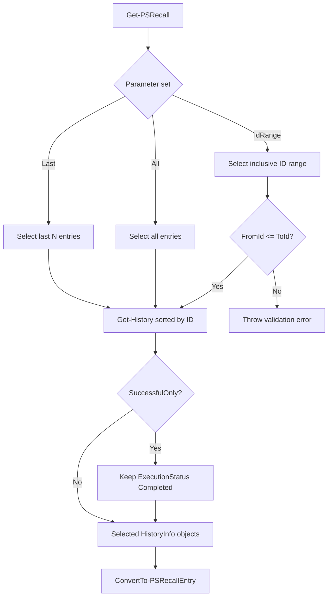
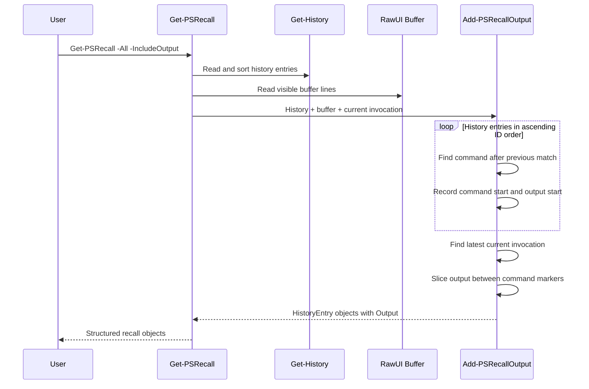
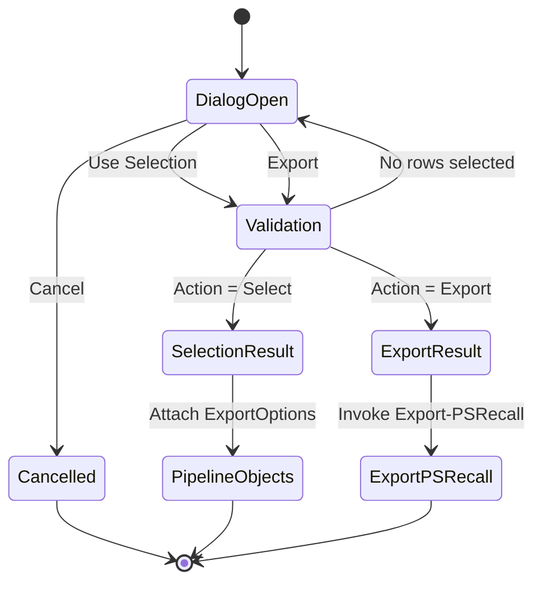
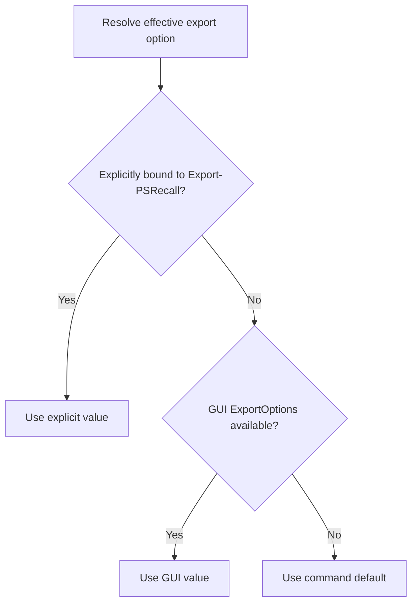
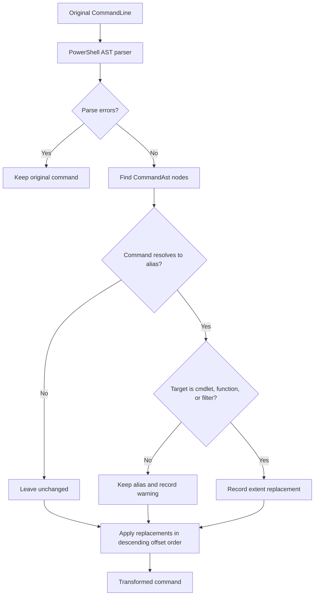
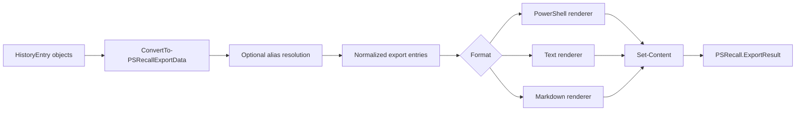
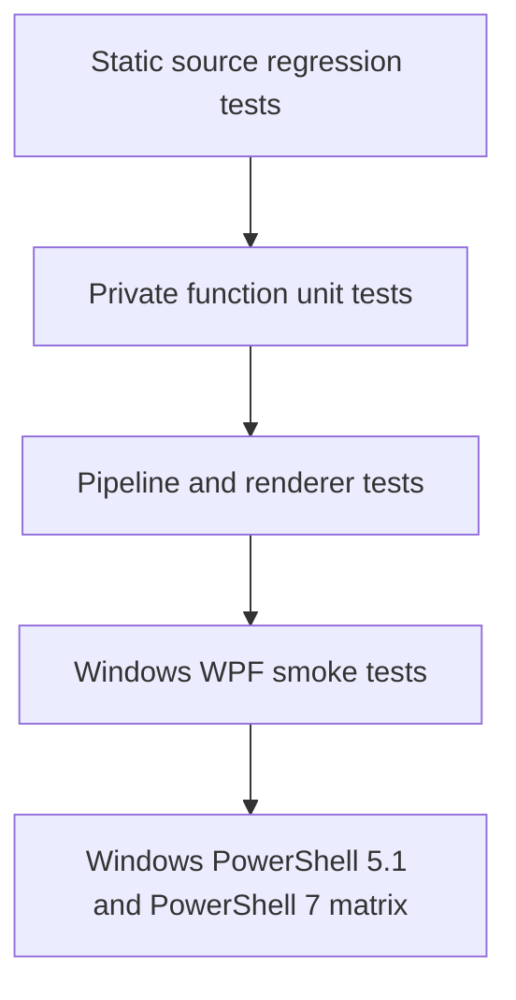
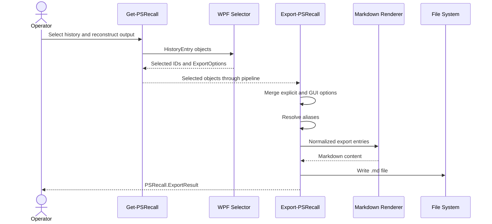

# PSRecall Design

> Architecture and design documentation for PSRecall 1.0.1

## 1. Purpose

PSRecall reconstructs useful PowerShell scripts and troubleshooting documentation from the history of the current interactive session after the work has already happened.

The module is intentionally retrospective. It is not a transcript recorder and it does not require a capture process to be started before troubleshooting begins. PSRecall reads the current PowerShell session history, optionally reconstructs output that is still present in the terminal buffer, allows the user to select relevant entries, and renders the result as PowerShell, plain text, or Markdown.

The guiding principle is:

> **EXPORT WHAT WORKED.**

## 2. Design goals

PSRecall is designed around the following goals:

1. **Retrospective recovery**  
   Recover commands after an interactive troubleshooting session instead of requiring prior recording.

2. **Non-invasive operation**  
   Never rerun recalled commands to reconstruct output or validate behavior.

3. **Structured data first**  
   Represent recalled commands as structured PowerShell objects and apply formatting only at the presentation boundary.

4. **Explicit transformations**  
   Preserve original commands unless the user explicitly requests transformations such as alias resolution.

5. **Flexible workflows**  
   Support direct object inspection, pipeline processing, WPF selection, direct GUI export, and scripted export.

6. **Readable exports**  
   Produce reusable PowerShell scripts, portable text reports, and semantic Markdown documentation.

7. **Minimal dependencies**  
   Use PowerShell and .NET capabilities already available in the supported runtime. The WPF interface is Windows-only and does not depend on `Out-GridView`.

## 3. Scope

### In scope

- Selection from the current process history returned by `Get-History`.
- Selection by last count, all entries, or inclusive ID range.
- Optional filtering to entries with `ExecutionStatus = Completed`.
- Preservation of multiline command text.
- Best-effort reconstruction of terminal output from the current host buffer.
- Interactive selection and export through WPF on Windows.
- Pipeline-based selection and export.
- AST-based alias resolution during export.
- PowerShell, plain-text, and Markdown output formats.
- Optional inclusion of output and sensitive environment metadata.

### Out of scope

- Continuous recording or transcription.
- Re-execution of commands to regenerate output.
- Guaranteed reconstruction of terminal output.
- Reconstruction of session state, variables, credentials, functions, imported modules, or current location at the time each command ran.
- Cross-platform GUI support.
- Automatic AI analysis or external service integration.

## 4. High-level architecture

```mermaid
flowchart LR
    User[User or pipeline] --> Get[Get-PSRecall]

    subgraph Acquisition[Acquisition]
        History[Get-History]
        Buffer[Host.UI.RawUI buffer]
    end

    History --> Selection[Get-PSRecallSelection]
    Selection --> Entry[ConvertTo-PSRecallEntry]
    Buffer --> Output[Add-PSRecallOutput]
    Entry --> Output
    Output --> RecallObjects[PSRecall.HistoryEntry objects]
    Entry --> RecallObjects

    RecallObjects --> Gui{GUI requested?}
    Gui -- No --> Pipeline[PowerShell pipeline]
    Gui -- Yes --> WPF[Show-PSRecallHistoryDialog]

    WPF --> SelectAction[Use Selection]
    WPF --> ExportAction[Export]
    SelectAction --> Options[Attach ExportOptions]
    Options --> Pipeline
    ExportAction --> Export[Export-PSRecall]
    Pipeline --> Export

    Export --> Transform[ConvertTo-PSRecallExportData]
    Transform --> Alias[Resolve-PSRecallAlias]
    Alias --> Render{Output format}
    Transform --> Render

    Render --> Ps1[ConvertTo-PSRecallScript]
    Render --> Txt[ConvertTo-PSRecallText]
    Render --> Md[ConvertTo-PSRecallMarkdown]

    Ps1 --> File[Output file]
    Txt --> File
    Md --> File
```



## 5. Module structure

```text
PSRecall/
├── PSRecall.psd1
├── PSRecall.psm1
├── README.md
├── LICENSE
├── Public/
│   ├── Get-PSRecall.ps1
│   └── Export-PSRecall.ps1
├── Private/
│   ├── Add-PSRecallOutput.ps1
│   ├── ConvertTo-PSRecallEntry.ps1
│   ├── ConvertTo-PSRecallExportData.ps1
│   ├── ConvertTo-PSRecallMarkdown.ps1
│   ├── ConvertTo-PSRecallScript.ps1
│   ├── ConvertTo-PSRecallText.ps1
│   ├── Get-PSRecallBufferLines.ps1
│   ├── Get-PSRecallSelection.ps1
│   ├── Invoke-PSRecallStaRunspace.ps1
│   ├── Resolve-PSRecallAlias.ps1
│   ├── Show-PSRecallHistoryDialog.ps1
│   └── Show-PSRecallSaveDialog.ps1
└── Tests/
    └── PSRecall.Tests.ps1
```

The root module dot-sources private functions before public functions and exports only `Get-PSRecall` and `Export-PSRecall`.

## 6. Public command responsibilities

### 6.1 `Get-PSRecall`

`Get-PSRecall` is the acquisition and selection boundary.

Responsibilities:

- Translate public parameter sets into a selection request.
- Retrieve entries from `Get-History` through `Get-PSRecallSelection`.
- Convert history entries into stable `PSRecall.HistoryEntry` objects.
- Optionally reconstruct terminal output when `-IncludeOutput` is used.
- Optionally invoke the WPF selector when `-Gui` is used.
- Return selected entries to the pipeline.
- Perform direct export when the user selects **Export** in the GUI.
- Attach GUI-selected export settings to recalled entries as `ExportOptions` when **Use Selection** is selected.

Supported selection modes:

- `-Last <n>`
- `-All`
- `-FromId <x> -ToId <y>`

Optional behavior:

- `-SuccessfulOnly`
- `-IncludeOutput`
- `-Gui`

### 6.2 `Export-PSRecall`

`Export-PSRecall` is the presentation and persistence boundary.

Responsibilities:

- Accept `PSRecall.HistoryEntry` objects from the pipeline.
- Preserve the optional `ExportOptions` metadata attached by the GUI.
- Resolve effective export settings.
- Validate output format and file extension.
- Open a format-aware save dialog when no path is supplied.
- Apply export transformations such as alias resolution.
- Dispatch entries to the selected renderer.
- Write the generated content using a runtime-appropriate UTF-8 encoding.
- Return a structured `PSRecall.ExportResult` object.

Supported formats:

| Format | Extension | Renderer |
|---|---|---|
| `PowerShell` | `.ps1` | `ConvertTo-PSRecallScript` |
| `Text` | `.txt` | `ConvertTo-PSRecallText` |
| `Markdown` | `.md` | `ConvertTo-PSRecallMarkdown` |

## 7. Core data contracts

### 7.1 `PSRecall.HistoryEntry`

The stable internal and pipeline-facing recall object is created by `ConvertTo-PSRecallEntry`.

| Property | Purpose |
|---|---|
| `Id` | Original PowerShell history ID |
| `ExecutionStatus` | Status reported by `Get-History` |
| `StartExecution` | Command start timestamp when available |
| `EndExecution` | Command end timestamp when available |
| `Duration` | Calculated command duration |
| `CommandLine` | Original multiline command text |
| `Output` | Best-effort reconstructed terminal output or `$null` |
| `ExportOptions` | Optional GUI-selected export settings |

The object carries the type name `PSRecall.HistoryEntry`.

### 7.2 `PSRecall.ExportOptions`

The WPF dialog attaches this object when the user chooses **Use Selection**.

| Property | Purpose |
|---|---|
| `Format` | PowerShell, Text, or Markdown |
| `Title` | Heading for Text and Markdown output |
| `IncludeOutput` | Whether reconstructed output is rendered |
| `ResolveAliases` | Whether aliases are resolved during export |
| `IncludeSensitiveMetadata` | Whether environment metadata is added |

### 7.3 `PSRecall.GuiResult`

The GUI returns a decision object rather than only selected IDs.

| Property | Purpose |
|---|---|
| `Action` | `Cancel`, `Select`, or `Export` |
| `SelectedIds` | Selected history IDs |
| `Format` | Selected export format |
| `Title` | Selected export title |
| `IncludeOutput` | GUI include-output choice |
| `ResolveAliases` | GUI alias-resolution choice |
| `IncludeSensitiveMetadata` | GUI metadata choice |

### 7.4 `PSRecall.ExportResult`

The export result reports what was written.

| Property | Purpose |
|---|---|
| `Path` | Resolved output path |
| `Format` | Effective export format |
| `EntryCount` | Number of exported history entries |
| `ResolvedAliasCount` | Number of aliases replaced |
| `ParseErrorCount` | Number of command parse errors encountered |
| `OutputEntryCount` | Number of entries whose output was rendered |

## 8. History selection flow



A history entry represents one PowerShell history item, not one visual terminal line. Multiline loops, functions, splatted commands, and script blocks remain part of the same `CommandLine` value.

## 9. Output reconstruction

### 9.1 Rationale

`Get-History` stores command history, not command output. PSRecall therefore treats output reconstruction as an optional, best-effort enhancement.

When `-IncludeOutput` is requested:

1. `Get-PSRecallBufferLines` reads the current host buffer through `Host.UI.RawUI.GetBufferContents()`.
2. `Add-PSRecallOutput` sorts all current history entries by ID.
3. Commands are correlated chronologically with visible buffer lines.
4. After a command match, the next search begins after the matched command.
5. Text between two matched commands is assigned to the earlier history entry as output.
6. The currently executing `Get-PSRecall` invocation is located from the bottom of the buffer and used only as the final upper boundary.
7. Leading and trailing empty lines are removed.
8. Commands are never rerun.

### 9.2 Correlation sequence



### 9.3 Important invariant

The chronological search cursor advances after each command match. This keeps repeated commands distinct:

```text
History ID 1: gci  -> first visible gci
History ID 2: gci  -> next visible gci
```

The active recall command is not treated as a history command. It is used only as the end boundary for the latest matched entry.

### 9.4 Failure behavior

If the host buffer cannot be read, `Get-PSRecall` emits a warning and returns normal recall objects with `Output = $null`.

Output reconstruction can be incomplete when:

- the host does not implement `RawUI.GetBufferContents()`;
- scrollback is maintained outside the PowerShell host buffer;
- the screen was cleared;
- older output left the available buffer;
- command text wrapped or rendered differently;
- remoting, nested prompts, full-screen applications, or alternate hosts changed buffer behavior;
- terminal glyphs cannot be reconstructed cleanly.

PSRecall output must not be treated as a guaranteed transcript.

## 10. GUI design

The WPF interface runs in a dedicated STA runspace through `Invoke-PSRecallStaRunspace`.

The dialog contains:

- a multi-select `DataGrid`;
- ID, status, start time, command, and output columns;
- multiline wrapping and tooltips for command and output;
- format selection;
- title input;
- include-output, resolve-aliases, and sensitive-metadata controls;
- **Use Selection**, **Export**, **Cancel**, **Select All**, and **Clear** actions.



### GUI portability

WPF is available only on Windows. The non-GUI retrieval and export pipeline remains usable on supported non-Windows PowerShell hosts, subject to host-specific output-buffer availability.

## 11. Export option precedence

GUI choices are stored in `ExportOptions` when the user chooses **Use Selection**. `Export-PSRecall` uses the following precedence:

1. Explicit parameters bound directly to `Export-PSRecall`.
2. GUI options carried by the first pipeline entry with `ExportOptions`.
3. Command defaults.



This makes the following behaviors predictable:

```powershell
# Uses GUI-selected format and title
Get-PSRecall -All -Gui |
    Export-PSRecall

# Explicit Markdown and title override GUI choices
Get-PSRecall -All -Gui |
    Export-PSRecall -Format Markdown -Title 'Customer Troubleshooting'
```

`Force` is not inherited from GUI state. Overwrite behavior remains an explicit export concern.

## 12. Alias resolution

Alias resolution is performed only when `-ResolveAliases` is requested.

`Resolve-PSRecallAlias`:

1. Parses each command with `System.Management.Automation.Language.Parser.ParseInput()`.
2. Finds `CommandAst` nodes.
3. Resolves command elements that currently map to aliases.
4. Restricts replacements to cmdlets, functions, and filters.
5. Uses AST extent offsets to replace only command names.
6. Applies replacements from the end of the string to the beginning so offsets remain valid.
7. Preserves the original command if parsing fails.



The transformation does not intentionally rewrite:

- strings;
- comments;
- property or method names;
- external application names;
- command names invoked dynamically through variables.

## 13. Rendering pipeline

The export pipeline separates transformation from presentation.



### PowerShell renderer

Produces a reusable `.ps1` file containing:

- a metadata header;
- strict mode and stop-on-error preamble;
- command comments with history ID and status;
- original or alias-resolved command text;
- optional reconstructed output as block comments.

Any `#>` sequence found in captured output is neutralized before output is embedded in a PowerShell block comment.

### Text renderer

Produces a portable `.txt` report with:

- document title;
- session metadata;
- separated history sections;
- status and command text;
- optional plain-text output.

### Markdown renderer

Produces semantic `.md` documentation with:

- configurable document title;
- session information table;
- one section per history ID;
- PowerShell fenced code blocks for commands;
- text fenced code blocks for output.

Embedded triple-backtick sequences are neutralized before inclusion in fenced blocks.

## 14. File handling

`Export-PSRecall` maps each format to an extension, suggested filename, and save-dialog filter.

| Format | Required extension | Suggested filename |
|---|---|---|
| PowerShell | `.ps1` | `RecoveredSession.ps1` |
| Text | `.txt` | `PSRecall-Session.txt` |
| Markdown | `.md` | `PSRecall-Session.md` |

Rules:

- A missing extension is added automatically.
- A conflicting extension is rejected.
- A format-aware save dialog is shown when `-Path` is omitted.
- Existing files require explicit `-Force`.
- `SupportsShouldProcess` provides `-WhatIf` and `-Confirm` behavior.
- PowerShell 7 uses UTF-8 without BOM; Windows PowerShell 5.1 uses its supported UTF-8 encoding.

## 15. Error handling

The module uses contextual terminating errors at module import, selection, GUI, and export boundaries.

Key behaviors:

- Invalid ID ranges throw before selection.
- Missing pipeline input throws in `Export-PSRecall`.
- Invalid format/extension combinations throw before writing.
- Existing files throw unless `-Force` is supplied.
- Host-buffer failures become warnings and do not prevent history retrieval.
- Alias parse failures preserve the original command and are reported in export metadata.
- STA runspace errors are collected and rethrown to the calling session.

## 16. Security and privacy

PSRecall processes data that can contain sensitive customer or environment information.

Potentially sensitive content includes:

- tenant, user, device, and application identifiers;
- customer and server names;
- local and network paths;
- access tokens, credentials, or secrets typed as arguments;
- REST payloads and error messages;
- destructive or environment-specific commands;
- personally identifiable information in command output.

Safeguards and expectations:

- Output capture is opt-in through `-IncludeOutput`.
- Sensitive metadata is opt-in through `-IncludeSensitiveMetadata`.
- Commands are never rerun.
- Arbitrary command content is not silently redacted or rewritten.
- Users must review exported content before storing, committing, sharing, or submitting it to an AI service.

## 17. Testing strategy

The current test suite focuses primarily on regression protection for previously observed failures.

Covered areas include:

- readable and valid `foreach` syntax;
- required XAML namespace declarations;
- valid environment metadata interpolation;
- GUI output binding and wrapping;
- preservation of chronological output-reconstruction markers;
- rejection of invalid `DataGrid.RowHeight="Auto"` configuration.

Recommended test layers:



### Required next test improvements

- Unit tests with mocked terminal buffer lines covering repeated commands.
- Unit tests for multiline commands and missing command markers.
- Tests for GUI option precedence versus explicit export parameters.
- Renderer tests for embedded block-comment and Markdown-fence terminators.
- Module import tests under Windows PowerShell 5.1 and current PowerShell 7.
- WPF smoke tests on Windows validating XAML load and control lookup.

## 18. Compatibility model

| Capability | Windows PowerShell 5.1 | PowerShell 7 on Windows | PowerShell 7 on Linux/macOS |
|---|---:|---:|---:|
| History selection | Yes | Yes | Yes |
| Pipeline processing | Yes | Yes | Yes |
| PowerShell/Text/Markdown export | Yes | Yes | Yes |
| AST alias resolution | Yes | Yes | Yes |
| WPF GUI | Yes | Yes | No |
| Terminal output reconstruction | Host dependent | Host dependent | Host dependent |

The module manifest declares PowerShell 5.1 as the minimum version. The GUI additionally requires Windows and the WPF assemblies.

## 19. Design decisions

### Structured objects instead of formatted strings

Recall information is represented as objects until the renderer boundary. This allows users to filter, inspect, test, and transform entries in the pipeline.

### Public/private separation

Only `Get-PSRecall` and `Export-PSRecall` are exported. Acquisition details, GUI implementation, transformations, and renderers remain private.

### No classes

`PSCustomObject` plus `PSTypeName` is sufficient for the current data contracts and keeps Windows PowerShell 5.1 compatibility straightforward.

### WPF instead of `Out-GridView`

The WPF selector provides a controlled multi-column UI, multiline output display, export settings, and direct export behavior without depending on `Out-GridView` availability.

### Best-effort output instead of recording

Output reconstruction preserves the retrospective identity of the module. The trade-off is that host-buffer output cannot be guaranteed.

### Export transformations occur late

Alias resolution is applied during export rather than retrieval so the original session data remains available to users and tests.

### Explicit export precedence

Explicit command parameters override GUI-carried options. This follows PowerShell expectations and keeps scripted behavior deterministic.

## 20. Constraints and known risks

| Risk | Impact | Current mitigation |
|---|---|---|
| Terminal buffer is incomplete | Missing or partial output | Best-effort contract and warning fallback |
| Command text appears in output before the prompt | Possible incorrect marker | Chronological search cursor reduces ambiguity |
| Identical commands are repeated | Output could be associated with wrong call | Search continues after each match |
| WPF regression | GUI fails to load | XAML regression tests and versioned fixes |
| Alias target depends on session state | Export may not be portable | Resolution is explicit and current-session based |
| Export contains sensitive information | Data exposure | Opt-in output/metadata and documented review requirement |
| Script depends on unrecalled session state | Export may not run standalone | Documentation and review requirement |

## 21. Future extensions

### Recommended

- Expand Pester coverage around buffer correlation and GUI option precedence.
- Add a repeatable Windows test matrix for Windows PowerShell 5.1 and PowerShell 7.
- Add comment-based help for every public parameter and workflow.
- Add versioned changelog entries for behavior and compatibility changes.

### Optional

- Add JSON export as a machine-readable transport format.
- Add a non-Windows interactive selector without changing the core object pipeline.
- Add explicit output-correlation diagnostics for unmatched history entries.
- Add a `-PassThru` option if future export behavior stops returning results by default.

### Future

- Optional AI-analysis integration built on exported structured data rather than embedded into history acquisition.
- A cross-platform Avalonia-based GUI provider if the dependency and packaging cost becomes justified.
- Pluggable redaction policies for known secret patterns, with preview and audit output.

## 22. End-to-end example

```powershell
$getParameters = @{
    All            = $true
    SuccessfulOnly = $true
    IncludeOutput  = $true
    Gui            = $true
}

$exportParameters = @{
    Format         = 'Markdown'
    Title          = 'Customer Troubleshooting'
    ResolveAliases = $true
    IncludeOutput  = $true
}

Get-PSRecall @getParameters |
    Export-PSRecall @exportParameters
```



## 23. Summary

PSRecall uses a deliberately layered architecture:

- `Get-History` remains the authoritative command source.
- Host-buffer reading is an optional enrichment layer.
- `PSRecall.HistoryEntry` objects are the pipeline contract.
- WPF is an optional Windows interaction layer.
- Export transformations are explicit and late-bound.
- Renderers are independent presentation boundaries.
- Persistence is centralized in `Export-PSRecall`.

This separation keeps the module useful for interactive troubleshooting, scripted automation, reusable PowerShell generation, and technical documentation without turning the project into a continuous recorder or a general-purpose terminal framework.


### 24. RawUI leading-output fallback

A large command can produce enough terminal output that its prompt line leaves the `RawUI` buffer before a following command is recalled. When the first visible command marker has exactly one earlier unmatched history entry, PSRecall 1.0.1 assigns the leading readable buffer region to that single entry. If two or more earlier commands are unmatched, PSRecall does not guess because the output boundary between those commands cannot be reconstructed reliably.
